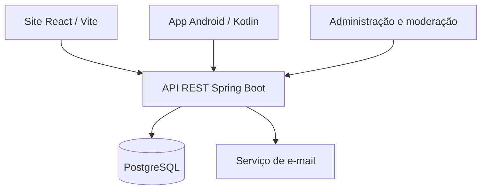

<div align="center">

# Valtrea Pulso

### Sua comunidade tem voz. Suas iniciativas ganham força.

**Plataforma de participação comunitária para registrar necessidades dos bairros, reunir apoio dos moradores e acompanhar a evolução de iniciativas locais.**

[**Acessar o site**](https://pulso.valtrea.com.br/) · [**Repositório**](https://github.com/adolfo-araujo/valtrea-pulso)

`Java 21` · `Spring Boot` · `PostgreSQL` · `React` · `Kotlin` · `Jetpack Compose`

</div>

---

## Sobre o projeto

O **Valtrea Pulso** conecta moradores em torno de melhorias para seus bairros. Cada pessoa pode identificar uma necessidade local, criar uma iniciativa, receber apoio de outros moradores e registrar atualizações sobre seu andamento.

A visualização das iniciativas é pública. Para publicar, apoiar ou denunciar, é necessário ter uma conta com e-mail confirmado.

O projeto reúne **API REST**, **aplicação web** e **aplicativo Android** no mesmo repositório, com regras de negócio e autorização concentradas no backend.

## Principais funcionalidades

- **Bairros:** seleção por cidade e nome, com normalização para evitar duplicidades causadas por diferenças de maiúsculas, espaços e acentos.
- **Iniciativas:** publicação com título, explicação e categoria, limitada a até **3 novas iniciativas por dia** e **20 iniciativas abertas por pessoa**.
- **Apoio comunitário:** cada usuário pode apoiar uma iniciativa uma vez e retirar seu apoio; ordenação por mais recentes ou mais apoiadas.
- **Acompanhamento:** o autor registra novidades e altera a fase da iniciativa entre **aberta**, **em andamento**, **resolvida** e **arquivada**.
- **Denúncias e moderação:** após denúncias de **3 pessoas diferentes**, a iniciativa fica oculta enquanto aguarda análise administrativa. O autor é notificado por e-mail sobre a decisão.
- **Acesso público:** qualquer visitante pode consultar iniciativas de um bairro, sem criar conta.
- **Conta e privacidade:** confirmação de e-mail, recuperação de senha, edição de perfil, exportação dos próprios dados e exclusão da conta.
- **Área administrativa:** fila de moderação e métricas agregadas de uso.

> Os limites e comportamentos acima correspondem às regras documentadas no projeto. Para conhecer o estado de cada implementação, consulte o código e a documentação técnica atualizados.

## Arquitetura e tecnologias

| Componente | Diretório | Tecnologias | Hospedagem documentada |
|---|---|---|---|
| API | `api/` | Java 21, Spring Boot, PostgreSQL, Flyway | Render |
| Site | `web/` | React, Vite, Tailwind CSS | Vercel |
| Android | `android/` | Kotlin, Jetpack Compose | Distribuição pela Google Play descrita no projeto |



**Links úteis:** [Site do Pulso](https://pulso.valtrea.com.br/) · [API no Render](https://valtrea-pulso-api.onrender.com/)

A API organiza as rotas sob o prefixo `/api/v1`. O README original também indica documentação interativa pelo Swagger UI em `/swagger-ui.html` (confira o caminho efetivo no ambiente publicado).

## Organização do repositório

```text
valtrea-pulso/
├── api/                  # Backend, regras de negócio e acesso a dados
├── web/                  # Interface web responsiva
├── android/              # Aplicação Android com Jetpack Compose
├── render.yaml           # Configuração de publicação da API
├── AUDITORIA-JURIDICA.md # Notas de conformidade e privacidade
└── README.md             # Documentação do projeto
```

## Fluxo de uso

1. O morador escolhe seu bairro ou cria um cadastro para ele, quando necessário.
2. Publica uma iniciativa informando o problema ou a melhoria proposta.
3. Outros moradores visualizam e apoiam a iniciativa.
4. O autor registra atualizações e acompanha a mudança de fase.
5. Denúncias podem encaminhar o conteúdo para moderação, conforme as regras da plataforma.

## Autenticação, segurança e privacidade

A documentação do projeto descreve as seguintes medidas:

- Autenticação com senha protegida por **bcrypt**, confirmação de e-mail e mecanismos de sessão e controle de tentativas de login.
- Restrições de acesso por usuário e por perfil administrativo.
- Limite de requisições por IP para ações sensíveis (documentado como **60 por hora**).
- Exposição pública apenas do primeiro nome do autor; identidades de apoiadores e denunciantes não são mostradas.
- Iniciativas ocultas respondem **HTTP 404** para quem não é o autor, até a decisão da moderação.
- Exclusão de conta com remoção das informações associadas, conforme as regras documentadas.
- Políticas de retenção para cadastros não confirmados, conteúdos ocultos e bairros inativos.
- Cabeçalhos de segurança, CORS restrito ao site, análise automatizada de dependências e segredos na integração contínua, além de backups criptografados descritos na documentação.

**Importante:** estas são medidas declaradas na documentação do projeto, não uma certificação ou auditoria de segurança independente. Segredos e senhas de produção não devem ser armazenados no repositório.

Para informações complementares, consulte [`AUDITORIA-JURIDICA.md`](./AUDITORIA-JURIDICA.md).

## API REST — visão geral

Todas as rotas abaixo utilizam o prefixo `/api/v1`.

| Método | Rota | Finalidade |
|---|---|---|
| `POST` | `/auth/cadastro`, `/auth/login`, `/auth/renovar`, `/auth/sair` | Cadastro e sessão |
| `POST` | `/auth/confirmar-email`, `/auth/reenviar-confirmacao` | Confirmação de e-mail |
| `POST` | `/auth/esqueci-senha`, `/auth/redefinir-senha` | Recuperação de acesso |
| `GET`, `PATCH`, `DELETE` | `/eu` | Perfil e exclusão da conta |
| `GET` | `/eu/dados` | Exportação dos próprios dados |
| `POST` | `/eu/termos` | Aceite dos termos vigentes |
| `PUT` | `/eu/bairro` | Seleção ou alteração de bairro |
| `GET` | `/eu/iniciativas` | Iniciativas do usuário |
| `POST` | `/bairros` | Localizar ou criar bairro |
| `GET` | `/bairros/{id}/iniciativas` | Iniciativas do bairro |
| `GET`, `POST` | `/iniciativas`, `/iniciativas/{id}` | Consultar e publicar |
| `PUT`, `DELETE` | `/iniciativas/{id}` | Editar e excluir (autor) |
| `POST` | `/iniciativas/{id}/atualizacoes` | Novidades e mudança de fase |
| `POST`, `DELETE` | `/iniciativas/{id}/apoio` | Apoiar ou retirar apoio |
| `POST` | `/iniciativas/{id}/denuncia` | Denunciar iniciativa |
| `GET` | `/publico/bairros`, `/publico/bairros/{id}` | Consulta pública |
| `GET` | `/publico/bairros/{id}/iniciativas` | Iniciativas públicas de um bairro |
| `GET` | `/publico/iniciativas/{id}` | Detalhes públicos |
| `GET`, `POST`, `DELETE` | `/admin/moderacao` e subrotas | Revisão administrativa |
| `GET` | `/admin/metricas` | Métricas agregadas |

> Esta tabela é um resumo das rotas mostradas na documentação, não substitui o contrato OpenAPI/Swagger da versão em execução.

## Executar localmente

### Pré-requisitos

- Java 21 e Maven para a API.
- Node.js e npm compatíveis com o `web/package.json`.
- PostgreSQL disponível localmente ou por uma instância de desenvolvimento.
- Android Studio, caso queira abrir o aplicativo Android.

### 1. Banco de dados

Inicie uma instância local de PostgreSQL (por exemplo, em um container Docker), crie um banco de desenvolvimento e **configure as credenciais fora do controle de versão**. Utilize a configuração do diretório `api/` para conferir o nome exato das variáveis de conexão.

### 2. API

No terminal Bash, após configurar o banco:

```bash
cd api
VALTREA_JWT_SECRET="$(openssl rand -hex 32)" \
VALTREA_URL_SITE="http://localhost:5175" \
VALTREA_CORS="http://localhost:5175" \
mvn spring-boot:run
```

A aplicação documenta a API na **porta 8080**. Para utilizar esse comando no PowerShell, configure as variáveis de ambiente com a sintaxe própria do Windows. Outras variáveis, como conexão PostgreSQL e serviço de e-mail, dependem do ambiente escolhido.

Sem SMTP configurado, a documentação informa que códigos e avisos de e-mail aparecem nos logs da API **no ambiente de desenvolvimento**. Não utilize esse comportamento em produção.

### 3. Site

Em outro terminal, na raiz do repositório:

```bash
cd web
npm install
npm run dev
```

O ambiente de desenvolvimento mostrado na documentação utiliza `http://localhost:5175` para o site e `http://localhost:8080` para a API. Confirme as variáveis e portas na versão atual do projeto.

### 4. Android

Abra `android/` no Android Studio, configure o endereço da API de acordo com o emulador ou dispositivo físico e execute a variante de desenvolvimento. O README original indica `http://10.0.2.2:8080/` como endereço da API no emulador Android.

## Publicação

A documentação existente descreve a seguinte distribuição:

1. **PostgreSQL (Neon):** criar um banco gerenciado e manter a região próxima à hospedagem da API para reduzir latência.
2. **API (Render):** configurar a implantação a partir do repositório, usando `render.yaml`, e fornecer as variáveis `DATABASE_URL`, `DATABASE_USER`, `DATABASE_PASSWORD` e `RESEND_API_KEY`, além dos segredos exigidos pela aplicação.
3. **Site (Vercel):** configurar o projeto com diretório-raiz `web/` e `VITE_API_URL` apontando para a API publicada.
4. **Domínio:** configurar o subdomínio `pulso.valtrea.com.br` de acordo com as instruções da plataforma de hospedagem.
5. **Android:** configurar a URL de produção no build de distribuição e validar o aplicativo antes de qualquer publicação em loja.

**Nunca faça commit de `.env`, senhas, chaves de API, tokens JWT ou arquivos de credenciais.** Consulte as opções de configuração existentes no projeto antes de publicar.

## Próximas melhorias

- Capturas ou vídeo curto das versões web e Android.
- Exemplos de respostas das principais rotas e coleção de requisições para teste da API.
- Diagrama do modelo de dados e documentação do fluxo de moderação.
- Cobertura de testes e indicadores de CI exibidos no README.
- Guia de contribuição e documentação da versão publicada na loja, se aplicável.

## Autoria

Projeto desenvolvido no contexto da **Valtrea**, com foco em tecnologia aplicada à participação comunitária.

[Valtrea](https://www.valtrea.com.br/) · [GitHub — adolfo-araujo](https://github.com/adolfo-araujo)

---

*Este repositório apresenta uma aplicação tecnológica independente. O registro de iniciativas pelos moradores não representa, por si só, uma solicitação oficial a órgãos públicos.*
